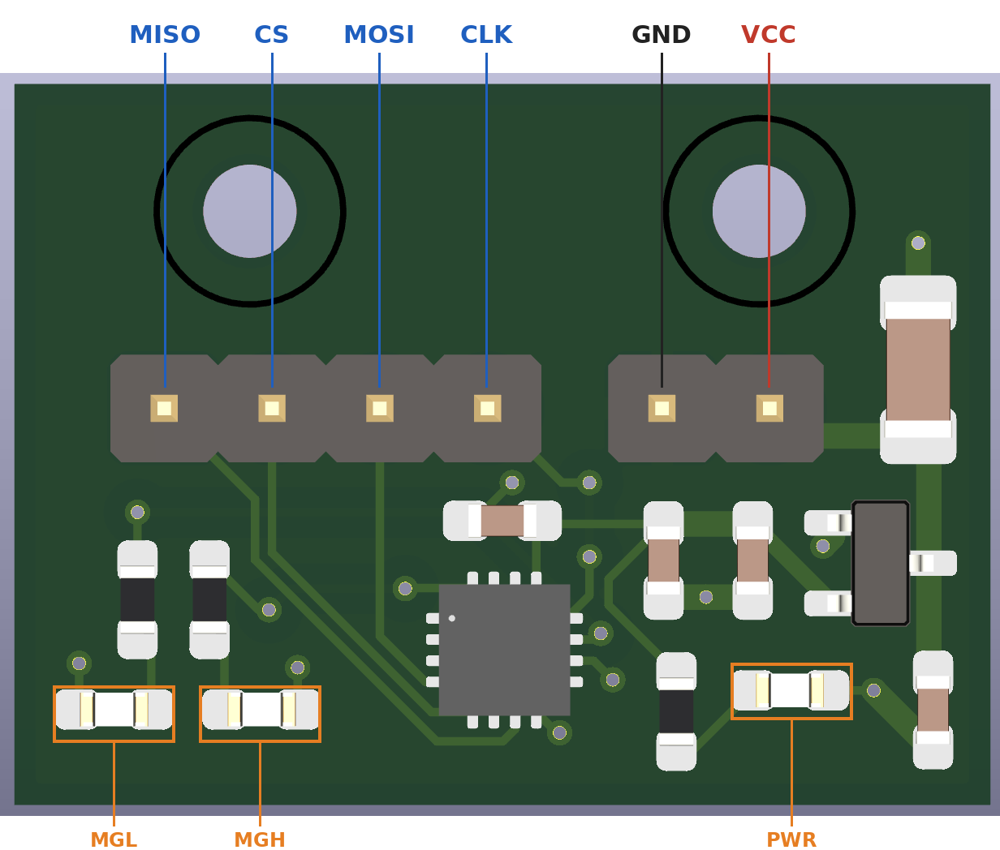

# Hall Encoder PCB

Off-axis magnetic angle sensor for the actuator output side. 23 × 17 mm, 2× M2 mounting holes.

## Function

- MA730 (MA732 compatible) measures the angle of a magnet placed off-axis
- Readout via SPI (MISO, MOSI, CS, CLK) at 3.3 V logic
- On-board LDO (AP2210-3.3) generates 3.3 V from VCC. **VCC: 4.3–13.2 V, 5 V recommended** (max. 15 V)

## LEDs

| LED | Meaning |
| --- | --- |
| PWR (D1) | 3.3 V present |
| MGH (D2) | Magnetic field too strong (magnet too close) |
| MGL (D3) | Magnetic field too weak (magnet too far / missing) |

Both MG LEDs off = magnet distance OK. Thresholds configurable via MA730 registers.

## Pinout

| Connector | Pins (left to right, top view) |
| --- | --- |
| J3 (1×4, 2.54 mm) | MISO, CS, MOSI, CLK |
| J6 (1×2, 2.54 mm) | GND, VCC |

## BOM

| Ref | Value | Package |
| --- | --- | --- |
| U3 | MA730 | QFN-16 3×3 |
| U1 | AP2210-3.3 (LDO) | SOT-23-3 |
| C1, C8, C9 | 100 nF | 0603 |
| C3 | 4.7 µF | 0603 |
| C2 | 10 µF | 1206 |
| R1–R3 | 330 Ω | 0603 |
| D1–D3 | LED | 0603 |
| J3 | Pin header 1×4 | 2.54 mm |
| J6 | Pin header 1×2 | 2.54 mm |

Full BOM: [hall_encoder.csv](hall_encoder.csv)
